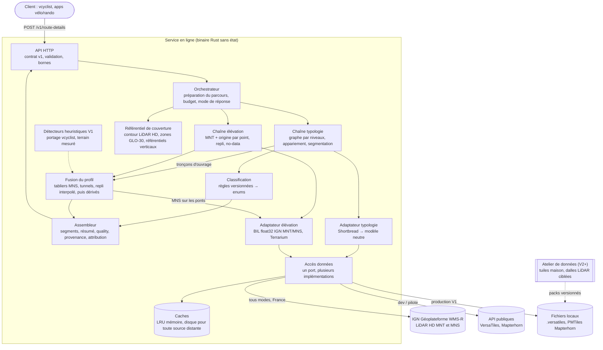

# 01 — Conception générale

> Statut : conception générale. Aucun code n'existe encore. Ce document applique l'arbitrage entre trois
> propositions : simplicité/MVP, qualité des données, exploitation/produit. Sa base factuelle est le
> [README](../../README.md) et les documents d'exploration [01](../exploration/01-vcyclist-elevation.md),
> [02](../exploration/02-osm-surface-typologie.md), [03](../exploration/03-sources-tuiles-vectorielles.md)
> et [04](../exploration/04-sources-elevation.md).
> Il décrit **quoi** est fait, à partir de **quelles** données et par **quel** composant. Il ne décrit
> pas **comment** : ni algorithme, ni paramètre, ni choix de crate. Le contrat d'API est dans
> [02-contrat-interface.md](02-contrat-interface.md).
>
> Révision : ce document a été réaligné sur l'étude de **vcyclist 6.11.0** (doc 01, qui remplace l'étude
> de la 5.0.1). Changements de fond : IGN LiDAR HD en direct comme source d'élévation en France, MNS
> LiDAR sur les ponts dès le MVP, heuristiques de vcyclist en contrôle croisé, provenance du terrain
> par tronçon, erreurs RFC 9457.

## 1. Vision

`osm-route-details` est un microservice Rust **sans état**. Il reçoit un parcours (une suite de points
GPS) et renvoie, le long de ce parcours :

- l'**élévation**, corrigée sur les ponts et les tunnels ;
- la **typologie** : la structure (sol, pont, tunnel) et le revêtement, sous forme d'enums simples ;
- pour chaque information, **d'où elle vient** et s'il s'agit d'un fait ou d'une inférence.

Ce que le service apporte par rapport à l'existant :

1. **OSM dit où est l'ouvrage, le LiDAR dit à quelle altitude.** Un MNT renvoie le fond de la vallée
   sous un viaduc et le sommet de la montagne au-dessus d'un tunnel : des creux ou des bosses de 10 à
   100 m, parfois davantage (doc 04 §5 ; 65,8 m sous le tablier à Saint-Nazaire, doc 01 §4).
   vcyclist 6.11 corrige déjà ces ouvrages, mais **sans OSM** : il les devine sur le profil LiDAR
   (MNS − MNT pour les ponts, forme du MNT pour les tunnels). Ses heuristiques sont réglées pour la
   précision et en ratent beaucoup : sur les séries tenues à l'écart, 4 ponts sur 11 et 6 tunnels sur
   7 (doc 01 §4, §5). Le service prend l'**emprise et le type** de l'ouvrage dans OSM, et son
   **altitude** dans le LiDAR HD en France : le MNS sur le tablier, le MNT aux portails des tunnels.
   L'interpolation entre culées, pratique de GraphHopper et Valhalla (dénivelé ramené de 1395 m à
   142 m chez GraphHopper), n'est qu'un **repli** : elle laisse 22 à 40 m d'erreur sur les grands
   ponts bombés (doc 01, enseignement 3). Les heuristiques de vcyclist, portées, servent de contrôle
   croisé et de filet pour les ouvrages absents d'OSM.
2. **Un contrat honnête.** Revêtu / non revêtu est fiable : 98 à 99 % d'accord avec Stadia, qui est
   une référence et non une vérité terrain (doc 02 §7). Une classe plus fine serait une inférence. Le
   contrat dit toujours d'où vient la valeur : tag explicite ou déduction par le type de voie
   (`surface.source`), tag OSM ou heuristique pour un ouvrage, et **terrain lu sur chaque tronçon**
   (LiDAR IGN mesuré, Mapterhorn, rien). Un D+ est toujours accompagné de son échelle et de son seuil
   (doc 01 §6.3).
3. **Aucune donnée à produire au démarrage.** Le MVP s'appuie sur des sources prêtes à l'emploi
   (VersaTiles, IGN LiDAR HD par la Géoplateforme, Mapterhorn). L'atelier de données hors ligne
   n'arrive que lorsqu'un besoin mesuré le justifie.

À ne pas promettre : le service ne corrige pas l'écart résiduel du D+ sur MNT face au baromètre,
remesuré par vcyclist à **+12 %** sur un parcours (714 m contre 637 m ; le « +35 % » de l'ancienne
étude n'est pas reproductible). Ni le zoom (z12 → z15 : 1,5 à 3 %) ni le recalage ne l'expliquent
(doc 01 §6.3). La correction des ouvrages se justifie par ses propres artefacts, qui sont les plus
grosses erreurs du profil.

## 2. Périmètre

### 2.1 Inclus (v1)

| Domaine | Contenu |
|---|---|
| Entrée | Un **tracé planifié** à vélo : liste de points lat/lon ou polyline encodée. |
| Élévation | Altitude par point après correction des ouvrages. Altitude lissée sur option. D+/D− avec leurs paramètres. Pente par tronçon. Méthode d'obtention de chaque valeur. Provenance du terrain par tronçon. |
| Structure | `ground`, `bridge`, `tunnel`, `unknown`, avec l'origine de la décision (tag OSM, heuristique, les deux). La valeur `ford` est réservée mais pas produite (§5.3). |
| Revêtement | `class` ∈ {`paved`, `unpaved`, `unknown`} avec sa provenance (`source`). Le champ `detail` est réservé. |
| Type de voie | `way_kind`, une enum courte dérivée de `highway`. Elle explique le revêtement inféré. |
| Qualité | Part appariée, part inférée, couverture de l'élévation, statut de la correction des ouvrages, avertissements localisés. |
| Traçabilité | Version de l'API, version des règles, versions des données. Attributions de licence dans **chaque** réponse (§8.6). |

### 2.2 Hors périmètre

- Le calcul d'itinéraire et le routage.
- La compatibilité Valhalla (`trace_attributes`, codes d'erreur Valhalla).
- L'**interprétation** du profil (détection de montées, physique, durées) : c'est le rôle de vcyclist.
  Le service fournit le profil sans l'interpréter.
- Le recalage de la trace sur la route pour améliorer l'altitude. Il a été mesuré inutile (R29, doc 01 §6.3).
- Les balcons et encorbellements, où le MNT lit la falaise ou la gorge : ni vcyclist ni OSM ne les
  traitent (doc 01 §6.2).
- Toute base OSM ou PostGIS en ligne. Le service ne lit que des tuiles et des rasters.
- Le stockage des parcours des utilisateurs.
- La détection de gués par heuristique géométrique (risque de faux positifs).

### 2.3 Reporté (avec déclencheur)

| Sujet | Étape | Déclencheur |
|---|---|---|
| Traces GPS enregistrées (bruitées), mode piéton | V2 | Jeu d'évaluation dédié. osm-surface n'a été validé que sur 3 tracés planifiés à vélo (doc 02 §7). |
| Revêtement fin (`detail`), `smoothness`, gué sur nœuds, `covered`, `layer`, `osm_id` | V2 | Un client doit distinguer gravier et terre, ou la fraîcheur des données devient un problème. |
| Gué sur les ways, `layer` | V1.x | Adaptateur OpenFreeMap, après évaluation. |
| Heuristiques de vcyclist (tabliers, tunnels) : contrôle croisé avec OSM et filet pour les ouvrages absents d'OSM | V1 | Portage validé sur les bancs de vcyclist. |
| Lecture du MNS sur la géométrie OSM du pont plutôt que sur la trace | V1.x | Mesure sur le corpus : traces qui passent à côté du tablier. |
| Harmonisation verticale | V3 | Raccords transfrontaliers mesurés gênants. |
| Confiance agrégée `high/medium/low` | V3 | Vérité terrain disponible pour la calibrer. |

## 3. Vue d'ensemble

Le MVP et la V1 tiennent dans **un seul processus**. Ses composants sont des modules, pas des
services. L'atelier de données hors ligne n'existe qu'à partir de la V2. Il est représenté en
pointillés.

Le flux d'une requête :

1. **Réception** : contrôle du format et des bornes (points, longueur, coordonnées dans la plage Web
   Mercator).
2. **Préparation** : suppression des doublons **consécutifs** seulement (un aller-retour ou une boucle
   repasse légitimement par les mêmes coordonnées), densification à pas métrique, distance curviligne
   cumulée. Ensuite, **tout est exprimé en distance le long du parcours**, jamais en nombre de points.
   Lissage et D+ restent ainsi indépendants de l'échantillonnage (doc 01, enseignement 5).
3. **En parallèle** :
   - la typologie lit les tuiles du couloir, construit le graphe par niveaux, apparie le parcours et le
     découpe en tronçons homogènes. Quand un ouvrage apparié sort du couloir (trace qui commence au
     milieu d'un long viaduc), elle lit les tuiles voisines jusqu'à ses extrémités ;
   - l'élévation lit le MNT aux points du parcours densifié (et non sur la trace appariée) : LiDAR
     IGN en France, Mapterhorn ailleurs et en repli. Elle note l'**origine** de chaque altitude et
     marque le no-data.
4. **Fusion** : correction des ouvrages, **avant tout lissage**. Sur les ponts appariés, lecture du
   MNS LiDAR et profil du tablier ; sur les tunnels, droite entre portails ; ailleurs, repli sur
   l'interpolation. En V1, les heuristiques passent sur le profil LiDAR en contrôle croisé. Puis
   comblement des trous courts, lissage s'il est demandé, D+/D− et pentes.
5. **Assemblage** : segments, points, résumé, bloc `quality` (dont la provenance du terrain par
   tronçon), avertissements, versions, attribution.

Les agrégats (D+/D−, pentes, extrema) sont calculés sur le profil interne densifié, quel que soit le
mode d'échantillonnage de la sortie : ils ne dépendent pas du nombre de points envoyés par le client.

**Déterminisme** : la même requête, avec les mêmes `api_version`, `rules_version` et `data_versions`,
donne la même réponse, hors `request_id` et durée. Le calcul n'a aucun effet de bord. Un client peut
donc mettre en cache et rejouer sans risque.

La typologie tourne **toujours**, même quand le client ne demande que l'élévation, parce que c'est
elle qui corrige les ouvrages. Le client peut désactiver explicitement cette correction.

## 4. Responsabilités des composants

| Composant | Responsabilité | Données |
|---|---|---|
| **API HTTP** | Contrat versionné, validation, bornes, compression, erreurs uniformes. | — |
| **Orchestrateur** | Prépare le parcours (densification, distances). Lance les deux chaînes sous un budget de temps. Décide du mode de réponse : complet, partiel accepté, ou erreur. | Parcours |
| **Accès données** | **Un seul port** de lecture de tuiles z/x/y, avec plusieurs implémentations : XYZ HTTP avec cache disque (dev et MVP), WMS `GetMap` dont l'emprise est celle de la tuile XYZ (IGN Géoplateforme, tous modes), fichier local `.versatiles` / PMTiles (V1 production), *range requests* vers un stockage objet maîtrisé (plus tard). Cadence par hôte **pour tout le processus** et relance des 429/503 (règles de vcyclist). Distingue « tuile vide » de « tuile introuvable » : une tuile introuvable n'est jamais lue comme « pas de rue ». Les échecs sont collectés **par requête**, le port étant partagé. | Toutes les sources |
| **Caches** | LRU mémoire de tuiles décodées, borné en octets, avec déduplication des chargements concurrents. Cache disque des octets bruts pour toute source distante, IGN comprise en production ; cache négatif court des tuiles en échec (règles au §8.3). | — |
| **Adaptateur typologie** | Décode la couche routes et la traduit vers un **modèle interne neutre « façon OSM »** : highway, surface brute ou regroupée, tracktype, bridge, tunnel, accès vélo… Seul cet adaptateur connaît Shortbread. | VersaTiles Shortbread z14 |
| **Chaîne typologie** | Reconstruit la topologie (recollage aux bords de tuile, jonctions), avec des niveaux sol/pont/tunnel **déconnectés**. Apparie le parcours (HMM repris d'osm-surface, sans la couche Valhalla). Produit des tronçons homogènes en distance et les suites d'ouvrages appariées avec leurs extrémités. | Modèle neutre |
| **Classification** | Traduit les attributs neutres vers les enums publiques (`structure`, `surface.class` et `source`, `way_kind`). La table de règles vit dans le service, jamais dans les tuiles. Elle est versionnée par `rules_version` et testable seule. | Règles (doc 02 §6) |
| **Adaptateur élévation** | Donne une altitude continue en tout point lat/lon, y compris aux bords de tuiles, la valeur d'un pixel étant celle de son **centre** pour toutes les sources (doc 01 §6.1). Décode le BIL float32 de l'IGN (MNT et MNS, no-data explicite) et le Terrarium de Mapterhorn (sans valeur no-data : une tuile absente ou une valeur aberrante doit être reconnue comme telle). Applique le repli : un point dont un voisin d'interpolation est no-data est relu **entièrement** dans Mapterhorn, jamais mélangé. Renvoie l'**origine** de chaque altitude. N'offre jamais de repli pour le MNS. | IGN LiDAR HD, Mapterhorn |
| **Référentiel de couverture** | Connaissance statique, à gros grain, de **où** chaque donnée est valable : contour de couverture du LiDAR HD (aucune requête IGN au-dehors), emprise des fichiers configurés (extraits), zones en GLO-30 (MNS), zones de référentiel vertical. Sert à distinguer « hors couverture » de « panne », à qualifier l'origine (`mapterhorn_measured` dans l'emprise France) et à émettre `dsm_source` et `vertical_datum_mixed`. Mapterhorn ne fournit pas de provenance par pixel (issue #350). | Configuration, contour repris de vcyclist, catalogue Mapterhorn |
| **Chaîne élévation** | Échantillonne le parcours densifié et produit l'altitude brute, ou « absente », avec son origine, à chaque échantillon. | — |
| **Fusion du profil** | Corrige les ouvrages (§5.5) : profil de tablier lu dans le MNS, droite entre portails, interpolation de repli. Comble les trous courts, lisse si demandé, calcule D+/D− et les pentes. Attache une **méthode** à chaque valeur. | Profil, tronçons d'ouvrage, MNS |
| **Détecteurs heuristiques** (V1) | Portage des détecteurs purs de vcyclist (tabliers par MNS − MNT, tunnels par la forme du MNT). Ne tournent que sur du terrain **mesuré**. Servent de contrôle croisé avec OSM et de filet pour les ouvrages absents d'OSM. | Profil LiDAR |
| **Assembleur** | Fusionne les tronçons, calcule le résumé et remplit le bloc `quality` : provenance factuelle, dont le terrain par tronçon. Ajoute avertissements, versions et attribution. | Résultats internes |
| **Observabilité** | Logs structurés **sans coordonnées**, métriques techniques et produit, sondes de santé. | — |

**Choix structurant : deux adaptateurs et un modèle neutre.** Changer de source revient à écrire un
adaptateur : OpenFreeMap, tuiles maison, dalles LiDAR locales. Le cœur (appariement, classification,
fusion, détecteurs) ne bouge pas. Changer de support (HTTP, fichier, stockage objet) revient à changer
d'implémentation du port d'accès. Les deux axes sont indépendants.

## 5. Stratégie de données

### 5.1 Élévation : sources et priorités

Le service reprend le schéma de vcyclist 6.11 (doc 01 §2) : **IGN LiDAR HD en direct en France,
Mapterhorn en repli et partout ailleurs.**

| Rang | Source | Nature | Usage |
|---|---|---|---|
| 1 (France) | **IGN LiDAR HD, MNT** : Géoplateforme WMS-R, BIL float32, z15 (≈ 3,4 m/px) | MNT LiDAR (terrain nu, grille 1 m) là où il est publié ; no-data ailleurs (zones non publiées, ZICAD) | Altitude du sol en France métropolitaine et en Corse |
| — (France) | **IGN LiDAR HD, MNS** : même service, même zoom | Sommet de tout : tabliers, mais aussi canopée et toits | **Seulement sur l'emprise d'un pont** (et, en V1, pour les heuristiques). Jamais comme sol, jamais comparé à un sol d'une autre source. |
| 2 | **Mapterhorn**, z12 par défaut | MNT national là où il existe (en France le LiDAR HD sous-échantillonné, sinon RGE ALTI ; DGM1, swissALTI3D…). Fond mondial GLO-30, qui est un **MNS**. | Repli point par point en France (no-data, panne IGN) ; source unique hors France |
| — | API publique `tiles.mapterhorn.com` | Même contenu | **Développement et pilote uniquement** ; en production, PMTiles auto-hébergé (planète z0–12 ≈ 356 Go, ou extrait par bbox) |
| — | API alti IGN (REST, 5 req/s) | MNT, MNS, MNH au point | Outil de **mesure** et de contrôle, jamais en production |

**Pourquoi l'IGN en direct**, alors que Mapterhorn sert déjà le LiDAR HD en France (à z12, 0,46 m RMS
du MNT LiDAR ; jusqu'à z17 disponible ; doc 01 §2.3) :

- **le MNS n'existe qu'à l'IGN**, et un tablier se lit en confrontant le MNS au MNT **de la même
  source** ;
- la **provenance** est connue : une altitude IGN est du LiDAR mesuré, alors que Mapterhorn ne publie
  aucune emprise par source ;
- c'est la chaîne que vcyclist a mesurée (bancs, seuils, provenance) : ses résultats sont réutilisables.

Le prix : environ 15 fois le volume de Mapterhorn (130 km à froid : 66 Mo et 19 s contre 2,3 Mo et
3 s), un BIL non compressé et une dépendance à un service en ligne (40 req/s/IP publiés, pas de SLA).
D'où un cache disque obligatoire, une cadence partagée par tout le processus et le repli sur
Mapterhorn (§6, §8.3, §9). Sur le sol seul, le gain est modeste (en Savoie, écart moyen 2 m, D+
identique à 0,2 % près) : l'IGN se justifie d'abord par les ouvrages et par la provenance. Un **mode
sobre** reste possible par configuration : Mapterhorn pour le sol partout, IGN interrogé seulement sur
l'emprise des ponts (MNT et MNS ensemble). Le choix pour la production est une question ouverte (§10).

**Règles de repli** (reprises de vcyclist) : hors du contour de couverture LiDAR, aucune requête IGN ;
no-data IGN sur un voisin d'interpolation → point relu entièrement dans Mapterhorn ; tuile IGN en échec
après relances → relue dans Mapterhorn, avertissement, et **pas de profil MNS** sur les ponts touchés
(repli sur l'interpolation). Une tuile en échec n'est jamais mise en cache comme valide.

**Zoom de Mapterhorn** : z12 suffit pour un repli. En France, il sert déjà du LiDAR ; monter en zoom
change peu le D+ (z12 → z15 : 1,5 à 3 %, R30), car les grosses erreurs viennent des ouvrages, pas de la
résolution. Hors France, z12 (pixel ≈ 13,5 m) n'est pas la résolution native des MNT nationaux : les
extrémités d'ouvrages y sont lues grossièrement, ce que le corpus mesurera. À z12, Mapterhorn arrondit
l'altitude à 50 cm (doc 04 §1) : sans effet sur un D+ à seuil de quelques mètres.

Ce que Mapterhorn met sous chaque zone (doc 04 §1, §2) : en France, LiDAR HD là où il est publié
(≈ 78 % de la surface en septembre 2026), sinon RGE ALTI, radar en montagne avec une erreur de l'ordre
de 7 m sur les fortes pentes. Mapterhorn comble les trous d'une source par la suivante jusqu'à GLO-30 :
un vrai trou ne vient que d'une tuile absente (hors emprise d'un extrait, défaut de la source).

**Provenance du terrain** (doc 01 §2.5) : chaque altitude porte une origine, exposée par tronçon.

| Origine | Mesurée | Sens |
|---|---|---|
| `ign_lidar_hd` | oui | MNT LiDAR IGN |
| `mapterhorn_measured` | oui | Mapterhorn dans l'emprise France (LiDAR dérivé ou RGE ALTI, banc mesuré par vcyclist) |
| `mapterhorn` | non | Mapterhorn ailleurs : MNT national ou GLO-30, indiscernables |
| `none` | non | Aucune donnée |

Un indicateur distingue en plus le repli **subi** (IGN en échec) du repli **normal** (hors LiDAR).
« Mesurée » conditionne les heuristiques (§5.5).

**Exclus** : FABDEM (licence non commerciale), Terrain Tiles AWS (plus maintenu), BD ALTI (obsolète).

**Sémantique annoncée de l'altitude** : « orthométrique nationale, non harmonisée ; MNS GLO-30
possible hors couverture MNT nationale ». Le LiDAR IGN est en IGN69. Ni le service ni Mapterhorn ne
convertissent les référentiels verticaux : marche de 0,76 m entre IGN69 et EGM2008 (GLO-30) en bordure
de couverture (estuaire de la Loire), 2,33 m entre Belgique et Pays-Bas. Le service signale les
traversées de zones de référentiel connues du référentiel de couverture (§4). L'harmonisation est
reportée à la V3. L'altitude n'est jamais une hauteur ellipsoïdale : un client ne doit pas la comparer
à l'altitude GPS brute (écart ≈ +50 m en France).

### 5.2 Typologie : sources

| Source | Rôle | Raison |
|---|---|---|
| **VersaTiles Shortbread z14** : HTTP en dev, fichier `.versatiles` local en production | **Primaire MVP et V1** | Seule source déjà évaluée : 86 à 94 % d'accord sur la classe, 98 à 99 % sur revêtu / non revêtu, moins de 100 ms à chaud. Elle porte `kind` (= highway brut) et `tracktype` brut, dont dépend l'inférence. Le téléchargement du fichier (62 Go) est l'usage prévu. |
| OpenFreeMap PMTiles auto-hébergé | Adaptateur **optionnel en V1.x** | Apporte `ford` (ways seulement), `layer` et une mise à jour hebdomadaire. Mais il n'a **pas** de `tracktype`, ce qui dégrade l'inférence, et l'appariement est calibré sur Shortbread. Ce n'est donc pas un remplacement transparent. On l'évalue d'abord sur les parcours de référence. |
| **Tuiles maison Planetiler**, schéma « route-details » | **Primaire V2** | Seule source avec `surface` brut, `smoothness`, `ford` sur ways **et** nœuds, `layer`, `covered`, `osm_id`, sans fusion de lignes. |
| OSMF, API publique OpenFreeMap, Protomaps | Écartées | Téléchargement en masse ou collecte automatisée interdits ; `surface` absent. |
| Index OSM PBF (ancienne voie d'osm-surface) | Non retenu | Les tuiles maison donnent les mêmes tags, sans jointure et sans ≈ 3 Go de RAM pour la France. |

### 5.3 Enum `Structure`

| Valeur | Sémantique | Source v1 |
|---|---|---|
| `ground` | Le tronçon apparié est au sol. Le MNT est l'altitude de la voie. Cela inclut le **passage sous un pont**. | Ni `bridge` ni `tunnel` |
| `bridge` | Le tronçon est sur un ouvrage qui franchit quelque chose. Le MNT y est faux. **Attention** : Shortbread y range aussi les passages à gué bétonnés (`low_water_crossing`). C'est documenté. Sans sursol dans le MNS, aucun tablier n'y est lu et l'altitude reste celle du sol : seule l'étiquette est trompeuse. On les reclassera quand une source le permettra. | `bridge=true` ; en V1, aussi un tablier détecté par heuristique hors de tout way `bridge` |
| `tunnel` | Le tronçon passe sous le terrain ou sous une couverture. Le MNT y est faux. Shortbread y range aussi `covered` et `building_passage`. Ils ne seront distingués qu'avec les tuiles maison. | `tunnel=true` ; en V1, aussi un tunnel détecté par heuristique sur terrain mesuré |
| `ford` | Gué. **Réservé dès la v1 mais jamais produit** tant qu'aucune source ne le porte. `/v1/capabilities` indique si la valeur est détectable. | — (V1.x / V2) |
| `unknown` | Portion non appariée (voie absente des tuiles, bridleway…). Un ouvrage non corrigé n'est pas exclu. | — |

### 5.4 Enum `Surface` (deux niveaux et une provenance)

- **`surface.class`**, **gelée pour toute la v1** :
  - `paved` : revêtu (asphalte, béton, pavés…) ;
  - `unpaved` : non revêtu (gravier, compacté, terre, herbe…) ;
  - `unknown` : portion non appariée, ou aucune information ni règle applicable.
- **`surface.detail`** : réservé et extensible, par exemple `asphalt`, `paving_stones`, `cobblestone`,
  `compacted`, `gravel`, `dirt`, `grass`. Il est **absent en v1**. Il n'est rempli qu'avec les tuiles
  maison (V2). Un client doit tolérer une valeur inconnue et la ramener à `class`.
- **`surface.source`** :
  - `tagged` : valeur explicite dans la source. Avec VersaTiles, c'est déjà un regroupement
    paved/unpaved ;
  - `inferred_tracktype` : déduit du `tracktype` ;
  - `inferred_highway` : déduit de la classe de voie, par les règles par défaut de la doc 02 §6
    (route → paved, track → unpaved…) ;
  - `none` : aucune déduction.

`surface.source` est toujours présent. C'est l'indicateur de confiance de la v1 : 25 à 60 % des ways
n'ont pas de `surface` (doc 03 §4).

**`way_kind`** : `major_road`, `minor_road`, `track`, `path`, `cycleway`, `footway`, `steps`,
`unknown` (doc 02 §9).

**`structure_source`** (origine de la décision d'ouvrage) : `osm` (tag seul), `heuristic` (détecteur
seul, V1), `osm_heuristic` (les deux concordent, V1). C'est l'indicateur de confiance par tronçon pour
les ouvrages. Au MVP, il vaut toujours `osm`.

### 5.5 Comment la typologie et le LiDAR corrigent l'élévation

Répartition des rôles avec vcyclist : vcyclist doit **deviner** l'ouvrage sur le profil ; le service le
**lit** dans OSM (emprise, type, continuité), et lit son altitude dans le LiDAR. Il **porte** de
vcyclist la construction du profil de tablier et les détecteurs, sans en reprendre la partie
détection pour les ouvrages qu'OSM connaît (doc 01, enseignement 3).

Sur chaque suite d'ouvrage appariée, l'altitude MNT est **remplacée** :

- **Pont, terrain LiDAR IGN** : profil du tablier lu dans le **MNS sur l'emprise OSM**, à la manière
  du constructeur de profil de vcyclist (ancres lisses, plafond de pente, raccord au terrain aux
  culées). L'emprise OSM remplace les tests de vcyclist qui écartent canopée et toits. Méthode
  `dsm_deck`.
- **Pont sans MNS exploitable** (hors LiDAR, MNS en échec, trop peu d'ancres) : interpolation entre
  les altitudes MNT prises juste à l'extérieur, aux culées. Méthode `interpolated_structure`. C'est un
  repli, connu pour s'écarter de plusieurs dizaines de mètres sur les grands ponts bombés.
- **Pont sans sursol** dans le MNS (tablier au ras du sol, gué bétonné classé `bridge`) : rien à
  corriger, l'altitude du sol est gardée.
- **Tunnel** : droite entre les altitudes MNT aux portails, prises **juste à l'extérieur** du way (le
  front de taille contamine sinon). Méthode `interpolated_structure`.

**Heuristiques (V1)** : les détecteurs de vcyclist, portés, tournent sur le profil LiDAR, **sur
terrain mesuré seulement** (sur GLO-30, une sonde de vcyclist a trouvé de faux tunnels). Ils servent :

- de **contrôle croisé** : un ouvrage OSM confirmé passe en `osm_heuristic` ; un ouvrage OSM non
  détecté reste `osm` sans être mis en doute, les détecteurs ratant beaucoup ;
- de **filet** : un tablier ou un tunnel détecté hors de tout way OSM signale un tag manquant
  (viaduc nord de Saint-Nazaire, ≈ 1 050 m, non tagué). Il est corrigé comme le fait vcyclist, avec
  `structure_source: heuristic` et un avertissement. En faire un simple avertissement reste une
  question ouverte (§10).

Invariants, tous applicables dès le MVP :

1. **Correction avant tout lissage.** Sinon le creux d'un viaduc contamine le profil bien au-delà de
   l'ouvrage (doc 01 §3, enseignement 5).
2. **Les extrémités sont celles de l'ouvrage**, et non les points où la trace y entre et en sort. Une
   trace qui commence au milieu d'un viaduc reste donc juste. C'est faisable sans `osm_id` : un pont
   reste une entité séparée après la fusion des lignes (doc 03 §5), et le graphe recolle les morceaux
   coupés aux bords de tuile. Si une extrémité reste hors des tuiles disponibles, l'invariant 4
   s'applique.
3. **Les ouvrages contigus forment un seul ouvrage** : pont puis tunnel, ou viaduc découpé en
   plusieurs ways.
4. **Pas de correction en cas de doute** : appariement incertain, extrémité sans altitude, portion
   `unknown` qui touche l'ouvrage. On garde alors le MNT brut et on émet un avertissement localisé.
   Corriger à tort fabrique un faux plat.
5. **La typologie tourne toujours en interne**, et le client peut désactiver la correction.
6. **Passage sous un pont et gué : MNT, sans correction.** Le niveau apparié reste le sol. Un pont
   « au-dessus » de la trace est écarté par la topologie (le way parcouru est-il le way `bridge` ?),
   là où vcyclist s'appuie sur son test de canyon.
7. **Chaque point porte sa méthode** : `dem`, `dsm_deck`, `interpolated_structure`, `gap_filled`,
   `none` (altitude absente).
8. **Une même portion d'ouvrage reçoit la même altitude à chaque passage** : un aller-retour, ou un
   demi-tour au milieu d'un pont, lit le même profil dans les deux sens.
9. **Le MNS n'est lu que sur un ouvrage**, jamais ailleurs : c'est aussi la canopée et les toits
   (sur un parcours de vcyclist, le MNS brut donne 1 267 m de D+ pour 37 m réels).
10. **Jamais de MNS IGN confronté à un sol d'une autre source** : un pont dont les culées sont lues
    dans Mapterhorn passe en interpolation.

Limites connues en v1 :

- un **pont ou un tunnel absent d'OSM, non tagué, ou dont la way n'est pas découpée** n'est pas vu
  au MVP : le creux ou la bosse reste dans le profil, sans avertissement. À partir de la V1, les
  heuristiques en rattrapent une partie sur terrain mesuré ; leurs échecs connus restent (ponts courts,
  tabliers sous superstructure lourde, arches pentues, tunnels courts, courbes ou sous colline douce,
  tranchées couvertes ; doc 01 §4, §5). Hors terrain mesuré, OSM est la seule source ;
- hors LiDAR, un pont bombé ou en rampe est approché par une droite ;
- une trace GPS qui passe **à côté** du tablier lit le MNS hors de l'ouvrage : lire sur la géométrie
  OSM est prévu en V1.x ;
- sans `layer`, deux ouvrages superposés se distinguent seulement par la continuité de l'appariement ;
- les pentes interpolées ne sont pas bornées. Un contrôle de plausibilité émet un avertissement, et le
  bornage sera décidé après le corpus d'ouvrages.

## 6. Données disponibles → comportement

Règle générale :

- une donnée **absente par conception ou par configuration** donne une réponse **200 qualifiée** ;
- une donnée **attendue mais indisponible à cause d'une panne** donne un **503 avec `Retry-After`**,
  après avoir essayé le cache périmé en secours ;
- une panne **absorbée par un repli configuré** (IGN en échec, Mapterhorn disponible) n'est pas une
  panne pour le client : 200, avertissement, provenance qui le montre. C'est le choix de vcyclist.

Une réponse partielle en cas de panne n'est renvoyée que si le client l'a explicitement acceptée. La
raison : pour vcyclist, recevoir sans le savoir une élévation non corrigée sur les ouvrages à cause
d'une panne passagère est pire que de réessayer.

| Situation | Comportement | Signal |
|---|---|---|
| Tout disponible | Réponse complète. | — |
| Trou court de no-data (seuil de longueur publié dans `/v1/capabilities`) | Comblé par interpolation. | méthode `gap_filled`, `elevation_gap_filled` |
| Trou long (hors emprise de l'extrait d'élévation, tuile absente de la source) | Altitude `null` sur la plage. D+ calculé sur les parties valides et marqué partiel. Les ouvrages qui touchent la plage ne sont pas corrigés. | `elevation_missing` + plages, `quality.elevation_coverage`, `status = partial` |
| Parcours hors emprise de l'extrait de typologie, sur une partie | Tronçons `unknown`, `matched: false`, MNT brut (ouvrages non corrigés). | `typology_missing` + plages, `status = partial` |
| Point sans LiDAR IGN (non publié, ZICAD, hors du contour France) | Relu dans Mapterhorn, sans requête IGN hors du contour. | `quality.terrain` (origine par tronçon) |
| Service IGN en échec ou en limitation, après relances | Tuiles relues dans Mapterhorn. Ponts touchés : interpolation au lieu du MNS. 200. | `terrain_fallback`, `dsm_unavailable` + plages |
| Pont OSM sans MNS exploitable (hors LiDAR, trop peu d'ancres) | Interpolation entre culées. | méthode `interpolated_structure` |
| Zone GLO-30 (MNS) | Lecture normale. Seuil de D+ adapté et annoncé, comme BRouter (§10). Détection à gros grain par le référentiel de couverture. Pas d'heuristiques. | `dsm_source` + plages |
| Traversée d'une frontière de référentiel vertical | Réponse normale. | `vertical_datum_mixed` |
| Ouvrage sans extrémités exploitables, ou appariement douteux | MNT brut conservé. | `structure_uncorrected` + plage |
| Pente implausible après interpolation | Valeur conservée. | `structure_slope_implausible` |
| Portion non appariée, données présentes (voie absente d'OSM ou des tuiles, bridleway, hors réseau, bac, points trop espacés pour suivre la voie) | `structure` et `surface.class` à `unknown`, MNT brut. La réponse reste `complete` : la donnée a été lue, la voie n'y est pas. | `unmatched_range` (« risque d'ouvrage non corrigé ») |
| Pont ou tunnel non tagué ou absent d'OSM | MVP : non détecté, MNT brut, `structure: ground`. V1, sur terrain mesuré : détecté par heuristique et corrigé. Ailleurs : non détecté. | MVP : aucun (§5.5). V1 : `structure_source: heuristic`, `structure_untagged` |
| Ouvrage OSM non confirmé par les heuristiques (V1) | Traitement normal : les détecteurs ratent beaucoup d'ouvrages réels. | `structure_source: osm` |
| Aller-retour, boucle, passage sous puis sur le même pont | Traitement normal : tout est indexé en distance le long du parcours ; le niveau (sol / pont) est décidé par la continuité de l'appariement. | — |
| Gué demandé mais source sans gué | `ford` jamais produit. | `/v1/capabilities` |
| Correction désactivée par le client | MNT brut sur les ouvrages. | `quality.structure_correction` à `disabled` |
| Source typologie en panne | 503. Si le partiel est accepté : élévation non corrigée, tronçons `unknown`. | `typology_unavailable`, `structure_correction` à `unavailable` |
| Élévation en panne (IGN **et** Mapterhorn, ou Mapterhorn hors France) | 503. Si le partiel est accepté : typologie seule, pas d'altitude. | `elevation_unavailable` |
| Les deux en panne | 503, toujours. | — |
| Une seule des deux sources couvre l'emprise (ex. extrait typologie France, parcours en Espagne) | 200 `partial`, avec la seule partie disponible. | `typology_missing` ou `elevation_missing` |
| Aucune donnée d'aucune source sur toute l'emprise | 422 `out_of_coverage`. Ne survient qu'avec des extraits : les fichiers planète couvrent tout. | — |
| Parcours au-delà des bornes (très long, trop de points) | 413. Le client découpe ; la correction d'un ouvrage coupé reste juste (extrémités de l'ouvrage), mais les D+ des morceaux ne s'additionnent pas exactement. | — |
| Budget de temps dépassé | 504 `timeout`. File saturée : 503 `overloaded`. Jamais de réponse tronquée en silence. | — |

## 7. Trajectoire

| Étape | Contenu | Déclencheur |
|---|---|---|
| **MVP** | VersaTiles en HTTP avec cache. Élévation : IGN LiDAR HD (MNT, et MNS sur les ponts) par WMS-R, avec cadence, relances, cache disque et repli Mapterhorn z12 en HTTP. Provenance du terrain par tronçon. Chaîne typologie d'osm-surface. Correction des ouvrages du §5.5 : tablier MNS sur les ponts OSM en France, interpolation de repli, droite entre portails pour les tunnels. Contrat v1 complet, avec `surface.class` seul, erreurs RFC 9457. Règle « panne → 503 ». Corpus d'ouvrages et bancs de vcyclist. | — |
| **V1 production** | Lecture locale de `.versatiles` et de PMTiles Mapterhorn (extraits par bbox). IGN WMS-R conservé en ligne, cache disque persistant (ou mode sobre, §5.1). API publiques VersaTiles et Mapterhorn **verrouillées hors mode dev**. **Portage des heuristiques** de vcyclist : contrôle croisé et filet sur terrain mesuré. `/v1/capabilities`, métriques produit. | Premier client en production |
| **V1.x** | Adaptateur OpenFreeMap optionnel (`ford` sur ways, `layer`), après évaluation. Lecture du MNS sur la géométrie OSM du pont. Décision sur le bornage des pentes d'ouvrage (l'avertissement existe dès le MVP). Sortie GeoJSON. Hors France, mesure d'un zoom Mapterhorn plus fin autour des extrémités d'ouvrages. | Besoin de gué ou de fraîcheur hebdomadaire ; résultats du corpus |
| **V2 : atelier typologie** | Tuiles maison Planetiler sur un extrait France : `surface.detail`, `smoothness`, gué sur nœuds, `covered`, `layer`, `osm_id`. Manifestes de packs, bascule à chaud, porte de qualité. Mode piéton et traces enregistrées, avec leur évaluation. | Besoin client de gravier / terre, ou fraîcheur |
| **V3 : atelier élévation** | Dalles LiDAR HD (MNT et MNS) téléchargées autour des ouvrages OSM, pour sortir de la dépendance au WMS-R si elle pose problème. Harmonisation verticale en option. MNS nationaux hors France (AHN…) si la mesure le justifie. Confiance agrégée calibrée. | Quotas ou disponibilité IGN insuffisants ; vérité terrain ; avancée de l'issue Mapterhorn #350 |

## 8. Exploitation

### 8.1 Livrable et déploiement

- Une image Docker minimale, non-root, avec un binaire unique, sur le modèle du Dockerfile
  d'osm-surface. Toute la configuration passe par des variables d'environnement : source et support de
  chaque chaîne, zoom, caches, concurrence, budget, bornes, mode dev.
- **Dev / pilote** : le service seul, sur les URL publiques, avec un cache disque. Le pilote sur l'URL
  publique VersaTiles n'est possible qu'après confirmation de ses conditions d'usage. L'exploration ne
  documente que la politique de téléchargement. Mapterhorn décourage l'usage automatisé massif.
- **Production V1** : un fichier `.versatiles` (planète ou extrait) et un extrait PMTiles Mapterhorn
  z0–12 sur un volume **en lecture seule**. Les API publiques VersaTiles et Mapterhorn sont
  verrouillées. Le WMS-R de l'IGN fait exception : service public, Licence Ouverte, cadence publiée ;
  il est lu en ligne, derrière un cache disque persistant sur un volume **inscriptible** à part.
- Pas d'authentification intégrée. Le service se place derrière un reverse proxy, qui gère TLS, clés et
  quotas (le 429 est délégué au proxy).

### 8.2 Mises à jour des données

- **Typologie** : une nouvelle release VersaTiles sort tous les 2 à 4 mois. On remplace le fichier et
  on redémarre, ce qui suffit pour un service sans état. La fraîcheur pèse ≈ 14 % des écarts
  d'osm-surface. La date des données est exposée.
- **Élévation** : à chaque release Mapterhorn pertinente, sans cadence fixe. Le LiDAR HD de l'IGN est
  publié progressivement : une tuile no-data en cache peut devenir valide, d'où une durée de vie
  limitée pour les tuiles IGN sans donnée.
- Mise à jour manuelle ou par un script ponctuel, **sans pipeline** avant la V2. La bascule à chaud et
  la porte de qualité arrivent avec l'atelier.
- Chaque réponse expose `data_versions`. Un écart entre deux réponses s'explique ainsi par les données
  ou par les règles (`rules_version`).

### 8.3 Cache

- **Mémoire** (tous modes) : LRU de tuiles décodées, borné en octets, avec déduplication des
  chargements concurrents.
- **Disque** (toute source distante, donc l'IGN en production), selon les règles éprouvées de vcyclist
  et d'osm-surface : on ne met en cache qu'une tuile valide (jamais un échec ni une page d'erreur), une
  entrée corrompue se répare d'elle-même, le cache périmé sert de secours en cas de panne, et l'espace
  de noms est lié à la source, au produit (MNT, MNS) et à sa version. Une tuile en échec est mémorisée
  comme illisible pendant un temps court, pour ne pas la redemander à chaque point. Les tuiles
  Mapterhorn sont immuables ; celles de typologie et les tuiles IGN sans donnée ont une durée de vie.
  Le cache est borné en taille ; il est **obligatoire** pour l'IGN (66 Mo à froid pour 130 km).
- **Cohérence des versions** : en mode fichier local, `data_versions` est exact (un fichier = une
  version). En mode distant, une réponse peut mêler des tuiles d'âges différents ; `data_versions` y est
  indicatif. C'est le cas permanent de l'IGN, lu en ligne : sa version est au mieux la date de lecture.
- **Cache de réponses** : aucun en v1. Le déterminisme (§3) permet au client ou au reverse proxy de
  cacher lui-même. Un cache côté service est envisageable en V2, désactivé par défaut : un parcours est
  une donnée personnelle.

### 8.4 Observabilité et vie privée

- Logs structurés par requête : durée par étape, tuiles en cache ou lues, statut, avertissements.
  **Jamais de coordonnées.**
- Métriques produit **étiquetées par `data_versions`** : part `unknown`, part inférée, ouvrages corrigés
  et non corrigés, réponses dégradées par motif. Une dérive après un changement de données devient
  visible.
- `/health/live`, `/health/ready` (données lisibles) et `/metrics` sur un port interne.

### 8.5 Qualité et non-régression

- Les 3 parcours d'osm-surface autour de Nantes (185 km, référence Stadia).
- Un **corpus d'ouvrages dès le MVP** : viaduc, tunnel de montagne, passage sous un pont, ponts
  contigus, trace qui commence sur un pont. osm-surface n'a jamais évalué `bridge` ni `tunnel`.
- Les **bancs de vcyclist** : itinéraires `docs/deck-strava-data/test1..4.gpx` (Saint-Nazaire, Nantes et
  ses 16 ponts de Loire, Mauves, Vercors et ses tunnels), vérité `analysis/truth/`, et sa discipline :
  séries tenues à l'écart, critères écrits avant, jugées une seule fois (doc 01 §6.4). Ses chiffres
  sont la ligne de base à battre (ponts : 18/21 en calibration, 4/11 hors échantillon ; tunnels : 6/7).
- Les points de contrôle de vcyclist (Mont Blanc, mer Morte, Badwater), en tests live hors CI.
- Une empreinte d'une tuile de référence décodée, en test hors ligne.

### 8.6 Licences et attributions

Le bloc `attribution` est présent dans **toute** réponse 200, quelles que soient les sections demandées :
avec `sections: ["elevation"]`, les données OSM servent quand même à corriger les ouvrages. Il ne
mentionne que les sources effectivement configurées.

- **OSM (ODbL)** : « © OpenStreetMap contributors » dans chaque réponse. La sortie est vraisemblablement
  un *Produced Work*. Le service ne redistribue aucune base dérivée, car le partage à l'identique
  s'appliquerait. Le contrat le rappelle aux clients : accumuler les réponses pour en faire une base
  de segments qualifiés les expose à la même clause.
- **IGN** : « © IGN — LiDAR HD, Licence Ouverte Etalab 2.0 ».
- **Mapterhorn** : environ 150 sources avec leurs licences (Etalab 2.0 pour l'IGN, mention Copernicus
  pour GLO-30, CC BY, OGL, DL-DE…). La réponse contient un lien vers la liste complète,
  `/v1/attribution`, accessible sans authentification, comme dans vcyclist.
- Comme dans vcyclist, la réponse porte l'attribution de la source **et** de son repli. La provenance
  par tronçon permet de savoir si l'IGN ou Mapterhorn ont servi ; à l'intérieur de Mapterhorn, le
  filtrage attend une provenance par pixel qui n'existe pas.
- **OpenMapTiles (CC-BY 4.0)** : « © OpenMapTiles » à ajouter si l'adaptateur OpenFreeMap est actif.
- **VersaTiles** : ODbL seul, aucune mention supplémentaire requise par l'exploration.
- **Exclusions de licence** : FABDEM (non commercial) ne doit jamais entrer, même comme repli.

## 9. Risques

| Risque | Impact | Parade |
|---|---|---|
| Conditions d'usage des API publiques VersaTiles et Mapterhorn | Blocage ou non-conformité | Réservées au dev et au pilote ; auto-hébergement dès la production ; cache agressif |
| **Dépendance au WMS-R de l'IGN** : quota (40 req/s/IP, partagé par tout le processus), pas de SLA, évolution ou retrait du service | Latence à froid (≈ 19 s pour 130 km), perte du MNS sur les ponts, profil moins sûr | Cache disque persistant ; cadence et relances ; repli Mapterhorn avec avertissement et provenance ; mode sobre ; dalles ciblées en V3 |
| Latence d'une requête froide sur l'IGN face au budget de temps | 504 sur de longs parcours inédits | Budget dimensionné sur le cas froid ; cache ; bornes ; mesure en pilote |
| Pont mal tagué ou mal apparié | Creux ou faux plat de plusieurs dizaines de mètres | Pas de correction en cas de doute, avertissements localisés, contrôle croisé heuristique (V1), corpus d'ouvrages |
| Pont hors LiDAR approché par une droite | 22 à 40 m d'erreur sur les grands ponts bombés | Méthode `interpolated_structure` exposée ; MNS nationaux hors France en V3 si mesuré |
| Extrémité d'ouvrage lue à z12 hors France (pixel ≈ 13,5 m) | Altitude de culée mêlée au fond de vallée | Mesure sur le corpus ; zoom plus fin ciblé en V1.x |
| RGE ALTI radar en montagne là où le LiDAR HD manque (≈ 7 m d'erreur sur fortes pentes) | Profils de cols dégradés là où ils comptent le plus | Visible dans la provenance (`mapterhorn_measured` au lieu de `ign_lidar_hd`) ; suivi de la couverture LiDAR HD |
| Pont ou tunnel non tagué dans OSM | Creux ou bosse non corrigé | MVP : limite documentée. V1 : heuristiques sur terrain mesuré ; hors terrain mesuré, la limite demeure |
| Faux positif d'heuristique (butte à ≥ 30 % prise pour un tunnel sur sentier ou VTT, toit lisse fusionné à un pont) | Vraie montée aplatie | Terrain mesuré seulement ; `structure_source: heuristic` et avertissement ; option d'avertissement seul (§10) |
| Divergence entre le portage Rust et les détecteurs Kotlin de vcyclist | Résultats différents sur les mêmes parcours, réglages dupliqués | Bancs communs et rejoués ; paramètres versionnés par `rules_version` ; mutualisation en question ouverte |
| Ouvrages superposés sans `layer` | Mauvais niveau apparié | Continuité de l'appariement ; `layer` en V1.x / V2 |
| `bridge` qui couvre les gués bétonnés (Shortbread) | Client induit en erreur | Documenté ; reclassement quand la source le permet |
| MNS GLO-30 hors couverture nationale | Faux dénivelé en forêt et en ville | Avertissement `dsm_source`, seuil de D+ adapté et annoncé |
| Marches de référentiel aux frontières | Faux D+ local | Sémantique annoncée, avertissement de traversée |
| Fraîcheur VersaTiles (2 à 4 mois) | Écarts avec le terrain récent | Date exposée ; OpenFreeMap (hebdomadaire) ou tuiles maison |
| Pérennité des sources (générateur VersaTiles archivé, OpenFreeMap porté par une seule personne) | Rupture d'approvisionnement | Fichiers conservés localement ; adaptateurs multiples ; tuiles maison en V2 |
| Client qui prend l'inféré pour un fait | Mauvaise expérience utilisateur | `surface.source` obligatoire, `class` séparé de `detail`, documentation |
| Volumétrie (62 Go de typologie, 356 Go d'élévation pour la planète, cache IGN qui grossit avec l'usage) | Coût disque | Extraits par bbox de la zone servie ; cache IGN borné |

## 10. Questions ouvertes

Tranchées par la révision sur vcyclist 6.11 : la convention de pixel (valeur au **centre** pour toutes
les sources, le décalage d'un demi-pixel est confirmé et corrigé dans vcyclist) ; le pont non tagué
(heuristiques sur terrain mesuré en V1, plutôt qu'un avertissement « creux suspect ») ; le MNS des ponts
(dès le MVP en France) ; le format d'erreur (RFC 9457, doc 02 §5.1).

1. **Premier client et volume** : vcyclist, tribly / Pédalons, autre ? Le volume décide quand on passe
   à l'auto-hébergement.
2. **Zone servie** : France, Europe de l'Ouest ou planète ? Elle fixe la taille des extraits et, plus
   tard, la machine de build.
3. **Revêtement** : revêtu / non revêtu suffit-il en v1, ou faut-il gravier / terre dès le départ ?
   Dans ce cas, les tuiles maison passent avant la V2.
4. **Gué** : est-il attendu à court terme ? Il déclenche l'adaptateur OpenFreeMap ou les tuiles maison.
5. **Politique de panne** : 503 par défaut avec acceptation explicite du partiel (proposé), ou réponse
   partielle par défaut ?
6. **Forme de sortie pour vcyclist** : valeurs aux points d'entrée sans lissage (proposé), profil à pas
   fixe, ou les deux ?
7. **Référentiel vertical** : l'altitude orthométrique nationale non harmonisée est-elle acceptable,
   frontières comprises (marche IGN69 / EGM2008 de 0,76 m en bordure du LiDAR) ?
8. **API publique VersaTiles** : vérifier ses conditions d'usage, ou passer directement au
   `.versatiles` local avant tout pilote ?
9. **Bornes** : faut-il dépasser les 200 km d'osm-surface pour la rando sur plusieurs jours ? Un
   endpoint asynchrone est-il envisageable ?
10. **Vérité terrain hors des bancs de vcyclist** : ses bancs couvrent la Loire-Atlantique et le
    Vercors. Peut-on étendre le corpus d'ouvrages (autres régions, hors France, GLO-30) et les traces
    barométriques ? Sans cela, ni les ponts hors LiDAR ni la confiance agrégée ne seront validés.
11. **Mutualisation** avec osm-surface et tribly : faut-il partager les fichiers de typologie, puis les
    tuiles maison ?
12. **Seuil de D+ en zone MNS** : adapter automatiquement le seuil du preset par défaut sur les plages
    GLO-30 (comme BRouter), ou garder un seuil unique choisi par le client et seulement avertir ?
13. **Référentiel de couverture** : le catalogue Mapterhorn donne-t-il des emprises exploitables pour
    détecter les zones GLO-30 et les frontières de référentiel ? Sinon, `dsm_source` et
    `vertical_datum_mixed` reposent sur une carte maintenue à la main (le contour LiDAR HD, lui, est
    repris de vcyclist).
14. **Qui sert qui, entre vcyclist et ce service ?** vcyclist a déjà sa chaîne HD et un service Ktor
    (`/elevation/along`, `/enhance`). Trois voies : le service remplace la chaîne de vcyclist, qui
    l'appelle pour l'élévation et la typologie ; le service ne fournit que la typologie (emprises
    d'ouvrages, revêtement) et vcyclist garde l'élévation ; ou le service délègue l'élévation à
    vcyclist. La réponse décide du périmètre du MVP et de la forme de sortie (question 6).
15. **Mutualisation du code Kotlin / Rust** : porter les détecteurs et le constructeur de profil en
    Rust (≈ 1 000 lignes, logique pure), au prix de deux implémentations à garder alignées ; ou une
    seule implémentation partagée (bibliothèque, appel de service) ; ou une spécification et des bancs
    communs seulement ?
16. **IGN en production** : la dépendance au WMS-R (quota par IP, pas de SLA) est-elle acceptable,
    avec cache et repli ? Ou faut-il le mode sobre (Mapterhorn pour le sol, IGN seulement sur les
    ponts), voire des dalles LiDAR locales autour des ouvrages dès la V1 ?
17. **Ouvrage vu par l'heuristique seule** : le corriger comme vcyclist (proposé, terrain mesuré
    seulement) ou se limiter à un avertissement « tag manquant », pour que la typologie reste purement
    OSM ?
18. **MNS lu sur la trace ou sur la géométrie OSM du pont** : quand la trace GPS passe à côté du
    tablier, laquelle donne le meilleur profil ? À mesurer avant la V1.x.
