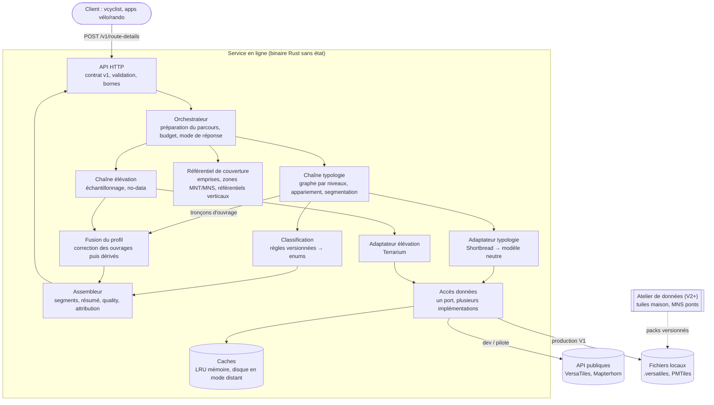

# 01 — Conception générale

> Statut : conception générale. Aucun code n'existe encore. Ce document applique l'arbitrage entre trois
> propositions : simplicité/MVP, qualité des données, exploitation/produit. Sa base factuelle est le
> [README](../../README.md) et les documents d'exploration [01](../exploration/01-vcyclist-elevation.md),
> [02](../exploration/02-osm-surface-typologie.md), [03](../exploration/03-sources-tuiles-vectorielles.md)
> et [04](../exploration/04-sources-elevation.md).
> Il décrit **quoi** est fait, à partir de **quelles** données et par **quel** composant. Il ne décrit
> pas **comment** : ni algorithme, ni paramètre, ni choix de crate. Le contrat d'API est dans
> [02-contrat-interface.md](02-contrat-interface.md).

## 1. Vision

`osm-route-details` est un microservice Rust **sans état**. Il reçoit un parcours (une suite de points
GPS) et renvoie, le long de ce parcours :

- l'**élévation**, corrigée sur les ponts et les tunnels ;
- la **typologie** : la structure (sol, pont, tunnel) et le revêtement, sous forme d'enums simples ;
- pour chaque information, **d'où elle vient** et s'il s'agit d'un fait ou d'une inférence.

Ce que le service apporte par rapport à l'existant :

1. **La typologie corrige l'élévation.** Un MNT renvoie le fond de la vallée sous un viaduc et le
   sommet de la montagne au-dessus d'un tunnel. Cela crée des creux ou des bosses de 10 à 100 m, et
   parfois davantage (doc 04 §5). vcyclist ne traite pas ces ouvrages (doc 01 §9). Pour les corriger,
   on interpole entre les extrémités de l'ouvrage, comme GraphHopper et Valhalla. GraphHopper cite un
   dénivelé ramené de 1395 m à 142 m.
2. **Un contrat honnête.** Revêtu / non revêtu est fiable : 98 à 99 % d'accord avec Stadia, qui est
   une référence et non une vérité terrain (doc 02 §7). Une classe plus fine serait une inférence. Le
   contrat dit toujours d'où vient la valeur : tag explicite ou déduction par le type de voie
   (`surface.source`). Un D+ est toujours accompagné de son échelle et de son seuil (doc 01 §8).
3. **Aucune donnée à produire au démarrage.** Le MVP s'appuie sur des sources prêtes à l'emploi
   (VersaTiles, Mapterhorn). L'atelier de données hors ligne n'arrive que lorsqu'un besoin mesuré le
   justifie.

À ne pas promettre : le service ne corrige pas la surestimation du D+ sur MNT en montagne mesurée par
vcyclist (+35 % face au baromètre). Sa cause n'est pas identifiée. Ni la résolution ni le recalage ne
l'expliquent (doc 01 §10). La correction des ouvrages se justifie par ses propres artefacts.

## 2. Périmètre

### 2.1 Inclus (v1)

| Domaine | Contenu |
|---|---|
| Entrée | Un **tracé planifié** à vélo : liste de points lat/lon ou polyline encodée. |
| Élévation | Altitude par point après correction des ouvrages. Altitude lissée sur option. D+/D− avec leurs paramètres. Pente par tronçon. Méthode d'obtention de chaque valeur. |
| Structure | `ground`, `bridge`, `tunnel`, `unknown`. La valeur `ford` est réservée mais pas produite (§5.3). |
| Revêtement | `class` ∈ {`paved`, `unpaved`, `unknown`} avec sa provenance (`source`). Le champ `detail` est réservé. |
| Type de voie | `way_kind`, une enum courte dérivée de `highway`. Elle explique le revêtement inféré. |
| Qualité | Part appariée, part inférée, couverture de l'élévation, statut de la correction des ouvrages, avertissements localisés. |
| Traçabilité | Version de l'API, version des règles, versions des données. Attributions de licence dans **chaque** réponse (§8.6). |

### 2.2 Hors périmètre

- Le calcul d'itinéraire et le routage.
- La compatibilité Valhalla (`trace_attributes`, codes d'erreur Valhalla).
- L'**interprétation** du profil (détection de montées, physique, durées) : c'est le rôle de vcyclist.
  Le service fournit le profil sans l'interpréter.
- Le recalage de la trace sur la route pour améliorer l'altitude. Il a été mesuré inutile (R29, doc 01 §10).
- Toute base OSM ou PostGIS en ligne. Le service ne lit que des tuiles et des rasters.
- Le stockage des parcours des utilisateurs.
- La détection de gués par heuristique géométrique (risque de faux positifs).

### 2.3 Reporté (avec déclencheur)

| Sujet | Étape | Déclencheur |
|---|---|---|
| Traces GPS enregistrées (bruitées), mode piéton | V2 | Jeu d'évaluation dédié. osm-surface n'a été validé que sur 3 tracés planifiés à vélo (doc 02 §7). |
| Revêtement fin (`detail`), `smoothness`, gué sur nœuds, `covered`, `layer`, `osm_id` | V2 | Un client doit distinguer gravier et terre, ou la fraîcheur des données devient un problème. |
| Gué sur les ways, `layer` | V1.x | Adaptateur OpenFreeMap, après évaluation. |
| MNS LiDAR HD sur l'axe des ponts, provenance par zone, harmonisation verticale | V3 | Gain mesuré par rapport à l'interpolation. |
| Confiance agrégée `high/medium/low` | V3 | Vérité terrain disponible pour la calibrer. |

## 3. Vue d'ensemble

Le MVP et la V1 tiennent dans **un seul processus**. Ses composants sont des modules, pas des
services. L'atelier de données hors ligne n'existe qu'à partir de la V2. Il est représenté en
pointillés.

Le flux d'une requête :

1. **Réception** : contrôle du format et des bornes (points, longueur, coordonnées dans la plage Web
   Mercator).
2. **Préparation** : suppression des doublons **consécutifs** seulement (un aller-retour ou une boucle
   repasse légitimement par les mêmes coordonnées), densification à pas métrique, distance curviligne
   cumulée. Ensuite, **tout est exprimé en distance le long du parcours**, jamais en nombre de points.
   Lissage et D+ restent ainsi indépendants de l'échantillonnage (doc 01, enseignement 3).
3. **En parallèle** :
   - la typologie lit les tuiles du couloir, construit le graphe par niveaux, apparie le parcours et le
     découpe en tronçons homogènes. Quand un ouvrage apparié sort du couloir (trace qui commence au
     milieu d'un long viaduc), elle lit les tuiles voisines jusqu'à ses extrémités ;
   - l'élévation lit le MNT aux points du parcours densifié (et non sur la trace appariée) et marque
     le no-data.
4. **Fusion** : correction des ouvrages, **avant tout lissage**, puis comblement des trous courts,
   lissage s'il est demandé, D+/D− et pentes.
5. **Assemblage** : segments, points, résumé, bloc `quality`, avertissements, versions, attribution.

Les agrégats (D+/D−, pentes, extrema) sont calculés sur le profil interne densifié, quel que soit le
mode d'échantillonnage de la sortie : ils ne dépendent pas du nombre de points envoyés par le client.

**Déterminisme** : la même requête, avec les mêmes `api_version`, `rules_version` et `data_versions`,
donne la même réponse, hors `request_id` et durée. Le calcul n'a aucun effet de bord. Un client peut
donc mettre en cache et rejouer sans risque.

La typologie tourne **toujours**, même quand le client ne demande que l'élévation, parce que c'est
elle qui corrige les ouvrages. Le client peut désactiver explicitement cette correction.

## 4. Responsabilités des composants

| Composant | Responsabilité | Données |
|---|---|---|
| **API HTTP** | Contrat versionné, validation, bornes, compression, erreurs uniformes. | — |
| **Orchestrateur** | Prépare le parcours (densification, distances). Lance les deux chaînes sous un budget de temps. Décide du mode de réponse : complet, partiel accepté, ou erreur. | Parcours |
| **Accès données** | **Un seul port** de lecture de tuiles z/x/y, avec plusieurs implémentations : XYZ HTTP avec cache disque (dev et MVP), fichier local `.versatiles` / PMTiles (V1 production), *range requests* vers un stockage objet maîtrisé (plus tard). Distingue « tuile vide » de « tuile introuvable » : une tuile introuvable n'est jamais lue comme « pas de rue ». | Toutes les sources |
| **Caches** | LRU mémoire de tuiles décodées, borné en octets, avec déduplication des chargements concurrents. En mode distant, cache disque des octets bruts (règles au §8.3). | — |
| **Adaptateur typologie** | Décode la couche routes et la traduit vers un **modèle interne neutre « façon OSM »** : highway, surface brute ou regroupée, tracktype, bridge, tunnel, accès vélo… Seul cet adaptateur connaît Shortbread. | VersaTiles Shortbread z14 |
| **Chaîne typologie** | Reconstruit la topologie (recollage aux bords de tuile, jonctions), avec des niveaux sol/pont/tunnel **déconnectés**. Apparie le parcours (HMM repris d'osm-surface, sans la couche Valhalla). Produit des tronçons homogènes en distance et les suites d'ouvrages appariées avec leurs extrémités. | Modèle neutre |
| **Classification** | Traduit les attributs neutres vers les enums publiques (`structure`, `surface.class` et `source`, `way_kind`). La table de règles vit dans le service, jamais dans les tuiles. Elle est versionnée par `rules_version` et testable seule. | Règles (doc 02 §6) |
| **Adaptateur élévation** | Donne une altitude continue en tout point lat/lon, y compris aux bords de tuiles. Décode Terrarium et signale explicitement le no-data (Terrarium n'a pas de valeur no-data : une tuile absente ou une valeur aberrante doit être reconnue comme telle). | Mapterhorn |
| **Référentiel de couverture** | Connaissance statique, à gros grain, de **où** chaque donnée est valable : emprise des fichiers configurés (extraits), zones couvertes par un MNT national et zones en GLO-30 (MNS), zones de référentiel vertical. Sert à distinguer « hors couverture » de « panne », et à émettre `dsm_source` et `vertical_datum_mixed`. Mapterhorn ne fournit pas de provenance par pixel (issue #350). | Configuration, catalogue des sources Mapterhorn |
| **Chaîne élévation** | Échantillonne le parcours densifié et produit l'altitude brute, ou « absente », à chaque échantillon. | — |
| **Fusion du profil** | Corrige les ouvrages (§5.5), comble les trous courts, lisse si demandé, calcule D+/D− et les pentes. Attache une **méthode** à chaque valeur. | Profil et tronçons |
| **Assembleur** | Fusionne les tronçons, calcule le résumé et remplit le bloc `quality` (provenance factuelle). Ajoute avertissements, versions et attribution. | Résultats internes |
| **Observabilité** | Logs structurés **sans coordonnées**, métriques techniques et produit, sondes de santé. | — |

**Choix structurant : deux adaptateurs et un modèle neutre.** Changer de source revient à écrire un
adaptateur : OpenFreeMap, tuiles maison, plus tard MNS IGN. Le cœur (appariement, classification,
fusion) ne bouge pas. Changer de support (HTTP, fichier, stockage objet) revient à changer
d'implémentation du port d'accès. Les deux axes sont indépendants.

## 5. Stratégie de données

### 5.1 Élévation : sources et priorités

| Rang | Source | Nature | Usage |
|---|---|---|---|
| 1 | **Mapterhorn**, zoom configurable, **z12 par défaut** | MNT national là où il existe (LiDAR HD et RGE ALTI en France, DGM1, swissALTI3D…). Fond mondial GLO-30, qui est un **MNS**. | Cas général |
| — | API publique `tiles.mapterhorn.com` | Même contenu | **Développement et pilote uniquement** |
| — | API alti IGN | MNT, MNS, MNH | Outil de **mesure** (prototype MNS des ponts, contrôles). Jamais en production : 5 req/s, pas de SLA. |
| V3 | MNS LiDAR HD sur l'axe des ponts (France) | MNS, classe tablier | Seulement si la mesure montre un gain par rapport à l'interpolation |

En production (V1), on lit un **fichier PMTiles Mapterhorn auto-hébergé** : la planète en z0–12
(≈ 356 Go) ou un extrait par bbox de la zone servie.

Pourquoi z12 : entre z12 et z15, le D+ change de 0,8 %, sans effet sur la durée, pour quatre fois plus
de tuiles par niveau (R30). Attention, z12 n'est **pas** la résolution native en France : la source y
va jusqu'à z17/18 (doc 04 §1). Le zoom natif (≈ 2 To pour la France) est donc écarté pour le MVP et la
V1. Il n'est envisagé que si une mesure le justifie, sur deux cas que R30 n'a pas couverts : les
extrémités d'ouvrages et les lacets. Une piste à évaluer : lire un zoom plus fin **seulement autour des
extrémités d'ouvrages**. À z12, Mapterhorn arrondit aussi l'altitude à 50 cm (doc 04 §1) : sans effet
sur un D+ à seuil de quelques mètres, mais à garder en tête pour les pentes de tronçons courts.

Ce que Mapterhorn met réellement sous chaque zone (doc 04 §1, §2) :

- **France** : LiDAR HD (MNT 0,5 m) là où il est publié (≈ 78 % de la surface en septembre 2026),
  sinon RGE ALTI. Le RGE ALTI vient du radar en montagne, avec une erreur de l'ordre de 7 m sur les
  fortes pentes : les cols non encore couverts par le LiDAR HD sont les moins bons.
- **No-data** : Mapterhorn comble les trous d'une source par la suivante, jusqu'à GLO-30 qui est
  mondial. Les zones ZICAD du LiDAR HD ne sont donc **pas** des trous dans Mapterhorn. Un vrai trou
  ne vient que d'une tuile absente (hors emprise d'un extrait, défaut de la source) ou d'une source
  directe ajoutée plus tard (MNS IGN en V3).

**Exclus** : FABDEM (licence non commerciale), Terrain Tiles AWS (plus maintenu), BD ALTI (obsolète).

**Sémantique annoncée de l'altitude** : « orthométrique nationale, non harmonisée ; MNS GLO-30
possible hors couverture MNT nationale ». Mapterhorn ne convertit pas les référentiels verticaux. La
marche Belgique / Pays-Bas atteint 2,33 m. Le service signale les traversées de zones de référentiel
connues du référentiel de couverture (§4). L'harmonisation est reportée à la V3. L'altitude n'est
jamais une hauteur ellipsoïdale : un client ne doit pas la comparer à l'altitude GPS brute (écart
≈ +50 m en France).

### 5.2 Typologie : sources

| Source | Rôle | Raison |
|---|---|---|
| **VersaTiles Shortbread z14** : HTTP en dev, fichier `.versatiles` local en production | **Primaire MVP et V1** | Seule source déjà évaluée : 86 à 94 % d'accord sur la classe, 98 à 99 % sur revêtu / non revêtu, moins de 100 ms à chaud. Elle porte `kind` (= highway brut) et `tracktype` brut, dont dépend l'inférence. Le téléchargement du fichier (62 Go) est l'usage prévu. |
| OpenFreeMap PMTiles auto-hébergé | Adaptateur **optionnel en V1.x** | Apporte `ford` (ways seulement), `layer` et une mise à jour hebdomadaire. Mais il n'a **pas** de `tracktype`, ce qui dégrade l'inférence, et l'appariement est calibré sur Shortbread. Ce n'est donc pas un remplacement transparent. On l'évalue d'abord sur les parcours de référence. |
| **Tuiles maison Planetiler**, schéma « route-details » | **Primaire V2** | Seule source avec `surface` brut, `smoothness`, `ford` sur ways **et** nœuds, `layer`, `covered`, `osm_id`, sans fusion de lignes. |
| OSMF, API publique OpenFreeMap, Protomaps | Écartées | Téléchargement en masse ou collecte automatisée interdits ; `surface` absent. |
| Index OSM PBF (ancienne voie d'osm-surface) | Non retenu | Les tuiles maison donnent les mêmes tags, sans jointure et sans ≈ 3 Go de RAM pour la France. |

### 5.3 Enum `Structure`

| Valeur | Sémantique | Source v1 |
|---|---|---|
| `ground` | Le tronçon apparié est au sol. Le MNT est l'altitude de la voie. Cela inclut le **passage sous un pont**. | Ni `bridge` ni `tunnel` |
| `bridge` | Le tronçon est sur un ouvrage qui franchit quelque chose. Le MNT y est faux. **Attention** : Shortbread y range aussi les passages à gué bétonnés (`low_water_crossing`). C'est documenté. L'interpolation y est sans dommage (l'ouvrage est au niveau du sol), seule l'étiquette est trompeuse. On les reclassera quand une source le permettra. | `bridge=true` |
| `tunnel` | Le tronçon passe sous le terrain ou sous une couverture. Le MNT y est faux. Shortbread y range aussi `covered` et `building_passage`. Ils ne seront distingués qu'avec les tuiles maison. | `tunnel=true` |
| `ford` | Gué. **Réservé dès la v1 mais jamais produit** tant qu'aucune source ne le porte. `/v1/capabilities` indique si la valeur est détectable. | — (V1.x / V2) |
| `unknown` | Portion non appariée (voie absente des tuiles, bridleway…). Un ouvrage non corrigé n'est pas exclu. | — |

### 5.4 Enum `Surface` (deux niveaux et une provenance)

- **`surface.class`**, **gelée pour toute la v1** :
  - `paved` : revêtu (asphalte, béton, pavés…) ;
  - `unpaved` : non revêtu (gravier, compacté, terre, herbe…) ;
  - `unknown` : portion non appariée, ou aucune information ni règle applicable.
- **`surface.detail`** : réservé et extensible, par exemple `asphalt`, `paving_stones`, `cobblestone`,
  `compacted`, `gravel`, `dirt`, `grass`. Il est **absent en v1**. Il n'est rempli qu'avec les tuiles
  maison (V2). Un client doit tolérer une valeur inconnue et la ramener à `class`.
- **`surface.source`** :
  - `tagged` : valeur explicite dans la source. Avec VersaTiles, c'est déjà un regroupement
    paved/unpaved ;
  - `inferred_tracktype` : déduit du `tracktype` ;
  - `inferred_highway` : déduit de la classe de voie, par les règles par défaut de la doc 02 §6
    (route → paved, track → unpaved…) ;
  - `none` : aucune déduction.

`surface.source` est toujours présent. C'est l'indicateur de confiance de la v1 : 25 à 60 % des ways
n'ont pas de `surface` (doc 03 §4).

**`way_kind`** : `major_road`, `minor_road`, `track`, `path`, `cycleway`, `footway`, `steps`,
`unknown` (doc 02 §9).

### 5.5 Comment la typologie corrige l'élévation

Sur chaque suite d'ouvrage appariée (pont ou tunnel), l'altitude MNT est **remplacée** par une
interpolation entre les altitudes MNT prises juste à l'extérieur de l'ouvrage, aux culées ou aux
portails. Invariants, tous applicables dès le MVP :

1. **Correction avant tout lissage.** Sinon le creux d'un viaduc contamine le profil bien au-delà de
   l'ouvrage (doc 01, enseignement 2).
2. **Les extrémités sont celles de l'ouvrage**, et non les points où la trace y entre et en sort. Une
   trace qui commence au milieu d'un viaduc reste donc juste. C'est faisable sans `osm_id` : un pont
   reste une entité séparée après la fusion des lignes (doc 03 §5), et le graphe recolle les morceaux
   coupés aux bords de tuile. Si une extrémité reste hors des tuiles disponibles, l'invariant 4
   s'applique.
3. **Les ouvrages contigus forment un seul ouvrage** : pont puis tunnel, ou viaduc découpé en
   plusieurs ways.
4. **Pas de correction en cas de doute** : appariement incertain, extrémité sans altitude, portion
   `unknown` qui touche l'ouvrage. On garde alors le MNT brut et on émet un avertissement localisé.
   Corriger à tort fabrique un faux plat.
5. **La typologie tourne toujours en interne**, et le client peut désactiver la correction.
6. **Passage sous un pont et gué : MNT, sans correction.** Le niveau apparié reste le sol.
7. **Chaque point porte sa méthode** : `dem`, `interpolated_structure`, `gap_filled`, `none`
   (altitude absente), plus tard `dsm_deck`.
8. **Une même portion d'ouvrage reçoit la même altitude à chaque passage** : un aller-retour, ou un
   demi-tour au milieu d'un pont, lit la même interpolation dans les deux sens.

Limites connues en v1 :

- un **pont absent d'OSM, non tagué, ou dont la way n'est pas découpée** n'est pas vu par la typologie :
  le creux du MNT reste dans le profil, **sans avertissement**. Le service ne détecte pas en v1 un creux
  suspect à partir de l'élévation seule (question ouverte §10) ;
- un pont bombé ou en rampe est approché par une droite ;
- sans `layer`, deux ouvrages superposés se distinguent seulement par la continuité de l'appariement ;
- les pentes interpolées ne sont pas bornées. Un contrôle de plausibilité émet un avertissement, et le
  bornage sera décidé après le corpus d'ouvrages.

## 6. Données disponibles → comportement

Règle générale :

- une donnée **absente par conception ou par configuration** donne une réponse **200 qualifiée** ;
- une donnée **attendue mais indisponible à cause d'une panne** donne un **503 avec `Retry-After`**,
  après avoir essayé le cache périmé en secours.

Une réponse partielle en cas de panne n'est renvoyée que si le client l'a explicitement acceptée. La
raison : pour vcyclist, recevoir sans le savoir une élévation non corrigée sur les ouvrages à cause
d'une panne passagère est pire que de réessayer.

| Situation | Comportement | Signal |
|---|---|---|
| Tout disponible | Réponse complète. | — |
| Trou court de no-data (seuil de longueur publié dans `/v1/capabilities`) | Comblé par interpolation. | méthode `gap_filled`, `elevation_gap_filled` |
| Trou long (hors emprise de l'extrait d'élévation, tuile absente de la source) | Altitude `null` sur la plage. D+ calculé sur les parties valides et marqué partiel. Les ouvrages qui touchent la plage ne sont pas corrigés. | `elevation_missing` + plages, `quality.elevation_coverage`, `status = partial` |
| Parcours hors emprise de l'extrait de typologie, sur une partie | Tronçons `unknown`, `matched: false`, MNT brut (ouvrages non corrigés). | `typology_missing` + plages, `status = partial` |
| Zone GLO-30 (MNS) | Lecture normale. Seuil de D+ adapté et annoncé, comme BRouter (§10). Détection à gros grain par le référentiel de couverture. | `dsm_source` + plages |
| Traversée d'une frontière de référentiel vertical | Réponse normale. | `vertical_datum_mixed` |
| Ouvrage sans extrémités exploitables, ou appariement douteux | MNT brut conservé. | `structure_uncorrected` + plage |
| Pente implausible après interpolation | Valeur conservée. | `structure_slope_implausible` |
| Portion non appariée, données présentes (voie absente d'OSM ou des tuiles, bridleway, hors réseau, bac, points trop espacés pour suivre la voie) | `structure` et `surface.class` à `unknown`, MNT brut. La réponse reste `complete` : la donnée a été lue, la voie n'y est pas. | `unmatched_range` (« risque d'ouvrage non corrigé ») |
| Pont non tagué ou absent d'OSM | Non détecté : MNT brut, `structure: ground`. | aucun (limite v1, §5.5) |
| Aller-retour, boucle, passage sous puis sur le même pont | Traitement normal : tout est indexé en distance le long du parcours ; le niveau (sol / pont) est décidé par la continuité de l'appariement. | — |
| Gué demandé mais source sans gué | `ford` jamais produit. | `/v1/capabilities` |
| Correction désactivée par le client | MNT brut sur les ouvrages. | `quality.structure_correction = disabled` |
| Source typologie en panne | 503. Si le partiel est accepté : élévation non corrigée, tronçons `unknown`. | `typology_unavailable`, `structure_correction = unavailable` |
| Source élévation en panne | 503. Si le partiel est accepté : typologie seule, pas d'altitude. | `elevation_unavailable` |
| Les deux en panne | 503, toujours. | — |
| Une seule des deux sources couvre l'emprise (ex. extrait typologie France, parcours en Espagne) | 200 `partial`, avec la seule partie disponible. | `typology_missing` ou `elevation_missing` |
| Aucune donnée d'aucune source sur toute l'emprise | 422 `out_of_coverage`. Ne survient qu'avec des extraits : les fichiers planète couvrent tout. | — |
| Parcours au-delà des bornes (très long, trop de points) | 413. Le client découpe ; la correction d'un ouvrage coupé reste juste (extrémités de l'ouvrage), mais les D+ des morceaux ne s'additionnent pas exactement. | — |
| Budget de temps dépassé | 504 `timeout`. File saturée : 503 `overloaded`. Jamais de réponse tronquée en silence. | — |

## 7. Trajectoire

| Étape | Contenu | Déclencheur |
|---|---|---|
| **MVP** | VersaTiles et Mapterhorn z12 en HTTP avec cache. Chaîne typologie d'osm-surface. Correction des ouvrages avec les invariants du §5.5. Contrat v1 complet, avec `surface.class` seul. Règle « panne → 503 ». Corpus d'ouvrages. | — |
| **V1 production** | Lecture locale de `.versatiles` et de PMTiles (extraits par bbox). API publiques **verrouillées hors mode dev**. `/v1/capabilities`, métriques produit. | Premier client en production |
| **V1.x** | Adaptateur OpenFreeMap optionnel (`ford` sur ways, `layer`), après évaluation. Décision sur le bornage des pentes d'ouvrage (l'avertissement existe dès le MVP). Sortie GeoJSON. Mesure d'un zoom plus fin autour des extrémités d'ouvrages. | Besoin de gué ou de fraîcheur hebdomadaire ; résultats du corpus |
| **V2 : atelier typologie** | Tuiles maison Planetiler sur un extrait France : `surface.detail`, `smoothness`, gué sur nœuds, `covered`, `layer`, `osm_id`. Manifestes de packs, bascule à chaud, porte de qualité. Mode piéton et traces enregistrées, avec leur évaluation. | Besoin client de gravier / terre, ou fraîcheur |
| **V3 : atelier élévation** | MNS LiDAR HD sur l'axe des ponts en France (dalles ciblées). Provenance par zone. Harmonisation verticale en option. Zoom plus fin là où la mesure le justifie. Confiance agrégée calibrée. | Gain mesuré ; vérité terrain ; avancée de l'issue Mapterhorn #350 |

## 8. Exploitation

### 8.1 Livrable et déploiement

- Une image Docker minimale, non-root, avec un binaire unique, sur le modèle du Dockerfile
  d'osm-surface. Toute la configuration passe par des variables d'environnement : source et support de
  chaque chaîne, zoom, caches, concurrence, budget, bornes, mode dev.
- **Dev / pilote** : le service seul, sur les URL publiques, avec un cache disque. Le pilote sur l'URL
  publique VersaTiles n'est possible qu'après confirmation de ses conditions d'usage. L'exploration ne
  documente que la politique de téléchargement. Mapterhorn décourage l'usage automatisé massif.
- **Production V1** : un fichier `.versatiles` (planète ou extrait) et un extrait PMTiles Mapterhorn
  z0–12 sur un volume **en lecture seule**. Les API publiques sont verrouillées.
- Pas d'authentification intégrée. Le service se place derrière un reverse proxy, qui gère TLS, clés et
  quotas (le 429 est délégué au proxy).

### 8.2 Mises à jour des données

- **Typologie** : une nouvelle release VersaTiles sort tous les 2 à 4 mois. On remplace le fichier et
  on redémarre, ce qui suffit pour un service sans état. La fraîcheur pèse ≈ 14 % des écarts
  d'osm-surface. La date des données est exposée.
- **Élévation** : à chaque release Mapterhorn pertinente. Il n'y a pas de cadence fixe.
- Mise à jour manuelle ou par un script ponctuel, **sans pipeline** avant la V2. La bascule à chaud et
  la porte de qualité arrivent avec l'atelier.
- Chaque réponse expose `data_versions`. Un écart entre deux réponses s'explique ainsi par les données
  ou par les règles (`rules_version`).

### 8.3 Cache

- **Mémoire** (tous modes) : LRU de tuiles décodées, borné en octets, avec déduplication des
  chargements concurrents.
- **Disque** (mode distant seulement), selon les règles éprouvées de vcyclist et d'osm-surface : on ne
  met en cache qu'une tuile valide (jamais un échec ni une page d'erreur), une entrée corrompue se
  répare d'elle-même, le cache périmé sert de secours en cas de panne, et l'espace de noms est lié à
  la source et à sa version. Les tuiles d'élévation sont immuables, celles de typologie ont une durée
  de vie. Le cache est borné en taille.
- **Cohérence des versions** : en mode fichier local, `data_versions` est exact (un fichier = une
  version). En mode distant, une réponse peut mêler des tuiles d'âges différents ; `data_versions` y est
  indicatif. C'est une raison de plus pour réserver le mode distant au développement.
- **Cache de réponses** : aucun en v1. Le déterminisme (§3) permet au client ou au reverse proxy de
  cacher lui-même. Un cache côté service est envisageable en V2, désactivé par défaut : un parcours est
  une donnée personnelle.

### 8.4 Observabilité et vie privée

- Logs structurés par requête : durée par étape, tuiles en cache ou lues, statut, avertissements.
  **Jamais de coordonnées.**
- Métriques produit **étiquetées par `data_versions`** : part `unknown`, part inférée, ouvrages corrigés
  et non corrigés, réponses dégradées par motif. Une dérive après un changement de données devient
  visible.
- `/health/live`, `/health/ready` (données lisibles) et `/metrics` sur un port interne.

### 8.5 Qualité et non-régression

- Les 3 parcours d'osm-surface autour de Nantes (185 km, référence Stadia).
- Un **corpus d'ouvrages dès le MVP** : viaduc, tunnel de montagne, passage sous un pont, ponts
  contigus, trace qui commence sur un pont. osm-surface n'a jamais évalué `bridge` ni `tunnel`.
- Les points de contrôle de vcyclist (Mont Blanc, mer Morte, Badwater), en tests live hors CI.
- Une empreinte d'une tuile de référence décodée, en test hors ligne.

### 8.6 Licences et attributions

Le bloc `attribution` est présent dans **toute** réponse 200, quelles que soient les sections demandées :
avec `sections: ["elevation"]`, les données OSM servent quand même à corriger les ouvrages. Il ne
mentionne que les sources effectivement configurées.

- **OSM (ODbL)** : « © OpenStreetMap contributors » dans chaque réponse. La sortie est vraisemblablement
  un *Produced Work*. Le service ne redistribue aucune base dérivée, car le partage à l'identique
  s'appliquerait. Le contrat le rappelle aux clients : accumuler les réponses pour en faire une base
  de segments qualifiés les expose à la même clause.
- **Mapterhorn** : environ 150 sources avec leurs licences (Etalab 2.0 pour l'IGN, mention Copernicus
  pour GLO-30, CC BY, OGL, DL-DE…). La réponse contient un lien vers la liste complète,
  `/v1/attribution`, accessible sans authentification, comme dans vcyclist. L'attribution filtrée par
  réponse attend une provenance fiable.
- **OpenMapTiles (CC-BY 4.0)** : « © OpenMapTiles » à ajouter si l'adaptateur OpenFreeMap est actif.
- **VersaTiles** : ODbL seul, aucune mention supplémentaire requise par l'exploration.
- **Exclusions de licence** : FABDEM (non commercial) ne doit jamais entrer, même comme repli.

## 9. Risques

| Risque | Impact | Parade |
|---|---|---|
| Conditions d'usage des API publiques | Blocage ou non-conformité | Réservées au dev et au pilote ; auto-hébergement dès la production ; cache agressif |
| Pont mal tagué ou mal apparié | Creux ou faux plat de plusieurs dizaines de mètres | Pas de correction en cas de doute, avertissements localisés, corpus d'ouvrages |
| Extrémité d'ouvrage lue à z12 (pixel ≈ 13,5 m) | Altitude de culée mêlée au fond de vallée | Mesure sur le corpus ; zoom plus fin ciblé en V1.x |
| RGE ALTI radar en montagne là où le LiDAR HD manque (≈ 7 m d'erreur sur fortes pentes) | Profils de cols dégradés là où ils comptent le plus | Documenté ; pas de signal en v1 faute de provenance par pixel ; suivi de la couverture LiDAR HD |
| Pont non tagué dans OSM | Creux non corrigé et non signalé | Limite documentée ; détection de creux suspect en question ouverte |
| Ouvrages superposés sans `layer` | Mauvais niveau apparié | Continuité de l'appariement ; `layer` en V1.x / V2 |
| `bridge` qui couvre les gués bétonnés (Shortbread) | Client induit en erreur | Documenté ; reclassement quand la source le permet |
| MNS GLO-30 hors couverture nationale | Faux dénivelé en forêt et en ville | Avertissement `dsm_source`, seuil de D+ adapté et annoncé |
| Marches de référentiel aux frontières | Faux D+ local | Sémantique annoncée, avertissement de traversée |
| Fraîcheur VersaTiles (2 à 4 mois) | Écarts avec le terrain récent | Date exposée ; OpenFreeMap (hebdomadaire) ou tuiles maison |
| Pérennité des sources (générateur VersaTiles archivé, OpenFreeMap porté par une seule personne) | Rupture d'approvisionnement | Fichiers conservés localement ; adaptateurs multiples ; tuiles maison en V2 |
| Client qui prend l'inféré pour un fait | Mauvaise expérience utilisateur | `surface.source` obligatoire, `class` séparé de `detail`, documentation |
| Volumétrie (62 Go de typologie, 356 Go d'élévation pour la planète) | Coût disque | Extraits par bbox de la zone servie |

## 10. Questions ouvertes

1. **Premier client et volume** : vcyclist, tribly / Pédalons, autre ? Le volume décide quand on passe
   à l'auto-hébergement.
2. **Zone servie** : France, Europe de l'Ouest ou planète ? Elle fixe la taille des extraits et, plus
   tard, la machine de build.
3. **Revêtement** : revêtu / non revêtu suffit-il en v1, ou faut-il gravier / terre dès le départ ?
   Dans ce cas, les tuiles maison passent avant la V2.
4. **Gué** : est-il attendu à court terme ? Il déclenche l'adaptateur OpenFreeMap ou les tuiles maison.
5. **Politique de panne** : 503 par défaut avec acceptation explicite du partiel (proposé), ou réponse
   partielle par défaut ?
6. **Forme de sortie pour vcyclist** : valeurs aux points d'entrée sans lissage (proposé), profil à pas
   fixe, ou les deux ?
7. **Référentiel vertical** : l'altitude orthométrique nationale non harmonisée est-elle acceptable,
   frontières comprises ?
8. **API publique VersaTiles** : vérifier ses conditions d'usage, ou passer directement au
   `.versatiles` local avant tout pilote ?
9. **Bornes** : faut-il dépasser les 200 km d'osm-surface pour la rando sur plusieurs jours ? Un
   endpoint asynchrone est-il envisageable ?
10. **Vérité terrain** : peut-on constituer un corpus d'ouvrages relevés et des traces barométriques ?
    Sans eux, ni le MNS des ponts ni la confiance agrégée ne pourront être validés.
11. **Mutualisation** avec osm-surface et tribly : faut-il partager les fichiers de typologie, puis les
    tuiles maison ?
12. **Convention centre ou coin de pixel** chez Mapterhorn : à vérifier avant de figer les tests de
    référence. vcyclist semble décalé d'un demi-pixel (doc 01 §4).
13. **Seuil de D+ en zone MNS** : adapter automatiquement le seuil du preset par défaut sur les plages
    GLO-30 (comme BRouter), ou garder un seuil unique choisi par le client et seulement avertir ?
14. **Pont non tagué** : faut-il en v1 un avertissement « creux suspect » tiré du seul profil, au risque
    de faux positifs (vallons réels) ?
15. **Référentiel de couverture** : le catalogue Mapterhorn donne-t-il des emprises exploitables pour
    détecter les zones GLO-30 et les frontières de référentiel ? Sinon, `dsm_source` et
    `vertical_datum_mixed` reposent sur une carte maintenue à la main.
